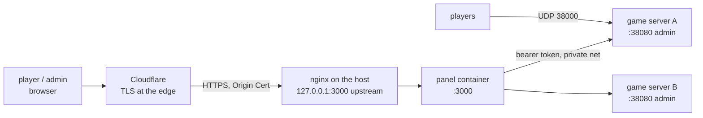

# Setup

Two things to stand up: **the panel** (public, behind Cloudflare → nginx on your host) and
**the game servers** (private; only the panel talks to them).



nginx is used because the host already serves other sites; the panel is published on
loopback only and nginx is the public entry point. Cloudflare sits in front of nginx.

---

## 0. Prerequisites

| Thing | Why |
| --- | --- |
| Docker + `docker compose` v2 on the host | runs the panel |
| nginx on the host | public entry point, TLS to Cloudflare |
| a domain on Cloudflare (proxied) | public hostname, e.g. `panel.example.com` |
| a Clerk account (free tier) | Discord sign-in |

```bash
docker --version && docker compose version
nginx -v
```

---

## 1. Clerk with Discord sign-in

1. <https://dashboard.clerk.com> → **Create application**.
2. *User & Authentication → Social connections* → **Discord** → enable. Clerk ships a
   shared Discord OAuth app; paste your own client id/secret only if you want your own
   branding.
3. Optionally disable email/password under *Email, phone, username* so the only button is
   "Continue with Discord".
4. In a **production** instance (Clerk keeps development and production separate):
   *Domains* → add `panel.example.com`.
5. Copy **Publishable key** (`pk_live_…`) and **Secret key** (`sk_live_…`).

The panel targets Clerk **v7 (Core 3)**; Clerk blocks older SDKs with an "outdated version of
Clerk" screen, so keep `@clerk/nextjs` on `latest` when you touch the panel.

You will sign in with Discord using the account whose email you put in
`PANEL_ADMIN_EMAILS` — that is what unlocks `/admin`.

---

## 2. Panel: run the setup script

```bash
cd sd-server/panel
./setup.sh --host panel.example.com
```

`setup.sh` is idempotent. It:

1. refuses to run without Docker/compose and a `Dockerfile`;
2. creates `.env` from `.env.example` (chmod 600) if missing — never overwrites yours;
3. writes `PANEL_PORT` (default `3000`) and `PANEL_PUBLIC_URL` into `.env`;
4. **stops** if `CLERK_SECRET_KEY`, `NEXT_PUBLIC_CLERK_PUBLISHABLE_KEY` or
   `PANEL_ADMIN_EMAILS`/`PANEL_ADMIN_USER_IDS` are empty (so you cannot end up with a
   panel nobody can administer), and warns when the user allowlist is empty or
   `PANEL_DEV_AUTH=1`;
5. `docker compose build` + `up -d`, publishing `127.0.0.1:3000` only;
6. waits for the panel to answer, then writes `nginx/panel.example.com.conf`.

Options: `--port 3100`, `--no-build`, `--skip-checks`, `--help`.

Fill `.env` (only these matter for a normal deployment):

```ini
PANEL_PUBLIC_URL=https://panel.example.com
CLERK_SECRET_KEY=sk_live_…
NEXT_PUBLIC_CLERK_PUBLISHABLE_KEY=pk_live_…
NEXT_PUBLIC_CLERK_SIGN_IN_URL=/sign-in
NEXT_PUBLIC_CLERK_SIGN_IN_FALLBACK_REDIRECT_URL=/
PANEL_ADMIN_EMAILS=you@example.com      # your Discord account's email in Clerk
PANEL_ALLOWED_EMAILS=                   # empty = any signed-in Clerk user; set to restrict
PANEL_ALLOWED_USER_IDS=
PANEL_DEV_AUTH=0
PANEL_PORT=3000
PANEL_DATA_FILE=/app/data/panel.json    # container path; the volume maps it
```

Then run `./setup.sh --host panel.example.com` again (or just `./setup.sh` — the script
only needs the values the second time around).

---

## 3. nginx on the host

Either let the script write the file for you (it prints the path):

```bash
sudo cp nginx/panel.example.com.conf /etc/nginx/sites-available/panel.example.com
sudo ln -sf /etc/nginx/sites-available/panel.example.com /etc/nginx/sites-enabled/
sudo nginx -t && sudo systemctl reload nginx
```

The template (`panel/nginx/panel.conf.example`) proxies to `127.0.0.1:<PANEL_PORT>`, adds
`X-Forwarded-*`, sets `Cache-Control: no-store` on `/api/`, and trusts Cloudflare's real
IP header (`set_real_ip_from` + `CF-Connecting-IP`) so logs and rate limits see visitors,
not Cloudflare.

Notes:

- If nginx itself runs in Docker, `127.0.0.1` is wrong — publish the panel on the docker
  bridge IP or add both containers to one network and use `http://panel:3000`.
- Keep your existing `server {}` blocks; the panel gets its own file in `sites-enabled`.
- `http2 on;` needs nginx ≥ 1.25.1; on older versions use `listen 443 ssl http2;`.

---

## 4. Cloudflare

1. **DNS**: `A` (and `AAAA` if you have IPv6) `panel` → your host IP, **proxied** (orange).
2. **SSL/TLS → Overview**: mode **Full (strict)**.
3. **SSL/TLS → Origin Server → Create certificate** for `panel.example.com` (15 years,
   free). Save the two files where the nginx config expects them:
   ```
   sudo mkdir -p /etc/ssl/cloudflare
   sudo install -m 600 panel.example.com.key /etc/ssl/cloudflare/panel.example.com.key
   sudo install -m 644 panel.example.com.pem /etc/ssl/cloudflare/panel.example.com.pem
   sudo systemctl reload nginx
   ```
   (Using certbot instead? Point `ssl_certificate*` at
   `/etc/letsencrypt/live/panel.example.com/` and skip the certificate step.)
4. **Rules → Cache Rules**: add a rule `URI Path starts with /api/` → **Bypass cache**.
   The panel polls JSON every few seconds; caching it would show stale data.
5. **SSL/TLS → Edge Certificates**: turn on *Always Use HTTPS* (optional, nginx also
   redirects).
6. Optional hardening:
   - *Security → WAF*: rate-limit `/api/*` (e.g. 60 requests/minute per IP) — the panel is
     polling, so keep it generous.
   - Block direct-to-origin traffic: allow only Cloudflare's ranges on 80/443
     (`https://www.cloudflare.com/ips/`) or enable *Authenticated Origin Pulls*.
   - No public IP on the host? Skip 443 entirely and use a **Cloudflare Tunnel**
     (`cloudflared service install`), pointing the tunnel at `http://127.0.0.1:3000`;
     then neither DNS A record nor open ports are needed.

---

## 5. First login and adding servers

1. Open `https://panel.example.com` → **Continue with Discord**.
2. You land on the overview (empty at first). The header shows an **admin** link because
   your email is in `PANEL_ADMIN_EMAILS`.
3. **admin → Add a server**: name, admin URL, token → **Test connection** (it calls that
   server's `/status`, so a bad token or unreachable host is caught before saving) →
   **Add server**.
4. Do the same for each server. Add a teammate under *Who can use the panel* if needed.

The admin URL is the server's **admin** port, not the game port:

| Where the server runs | Admin URL the panel uses |
| --- | --- |
| same Docker host, same network | `http://<container-name>:38080` |
| another host on a VPN (WireGuard/Tailscale) | `http://<overlay-ip>:38080` |
| another host, no VPN | `http://<ip>:38080`, firewalled to the panel's IP only |

The bearer token is what the server prints at boot
(`[ModTheIsland] admin API on http://0.0.0.0:38080 (bearer token …)`); pin it with
`ADMIN_TOKEN` in that server's environment so it survives restarts.

---

## 6. Game servers

On each game host (see the root `README.md` for the full story):

```bash
# one server
cp .env.example .env      # SERVER_NAME, MAX_PLAYERS, SERVER_PORT, ADMIN_PORT
# put the game's "Dedicated Server" folder into ./data (or let the egg's steamcmd do it)
docker compose up -d

# several on one node
docker compose -f docker-compose.multi.yml up -d
```

Keep the admin port private — the panel is the only client:

```bash
sudo ufw allow from <panel-ip> to any port 38080 proto tcp
sudo ufw delete allow 38080/tcp          # if you opened it earlier
```

Pterodactyl: import `pterodactyl/egg-screw-drivers-server.json`, allocate the UDP game
port **and** the TCP admin port, then add `http://<node-ip>:<admin port>` in the panel.

If an install aborts halfway (or steamcmd parks the depot under
`$HOME/Steam/steamapps/common/Screw Drivers`), just run the installer again: it now finds
the `Dedicated Server` folder wherever it landed, copies it to the volume root and removes
steamcmd's leftover library. `start.sh` and the mod are written before any download, so a
half-finished install still boots and logs what is missing.

Two details that bite:

- the **primary allocation is the game port**: wings injects it as `SERVER_PORT`, so the egg
  has no port variable for it (Pterodactyl *reserves* `SERVER_PORT`, `SERVER_IP`,
  `SERVER_MEMORY`, `STARTUP`, `ENV`, `HOME`, `USER`, `UUID`, `SERVER_UUID` — an egg that
  defines one fails to import with `The selected env variable is invalid`);
- put the **second allocation's** port into the `Admin Port` variable, and set
  `Admin Token` to a fixed value so the panel keeps working across restarts;
- **one allocation is enough** if you set `Admin Port` to the *game* port: wings publishes
  every allocation as `port/tcp` **and** `port/udp`, the game only takes UDP and the admin
  API takes TCP, so they never collide;
- `Admin Bind Address` must stay **0.0.0.0**. The container has no interface with the
  node's public IP, so binding that (a natural-looking choice) fails and the API never
  listens — `start.sh` now warns about it and prints
  `[sd] admin api : answering on 127.0.0.1:<port>` or a `NOT answering` block after boot.

### The admin API is not reachable from outside

The admin port is an **allocation** like the game port: wings publishes exactly the server's
allocations, so a number that was only typed into `Admin Port` (and never allocated) is
unreachable even though the plugin binds it inside the container. Run this ladder, in order:

```bash
# 0. what actually happened to the request (curl -s hides the error)
curl -sS -m 5 -o /dev/null -w '%{http_code}\n' \
  -H "Authorization: Bearer <token>" http://<node>:25600/status

# 1. does the server own a 25600 allocation, on which IP?
curl -s -H "Authorization: Bearer ptla_…" \
  "https://ptero.example.com/api/application/servers/12?include=allocations" \
  | jq -r '.attributes.relationships.allocations.data[].attributes | "\(.ip) \(.port) \(.ip_alias)"'

# 2. on the node: is the container publishing it?
docker ps --format '{{.Names}} {{.Ports}}' | grep 25600

# 3. on the node: does the API answer locally?
curl -s -o /dev/null -w '%{http_code}\n' -H "Authorization: Bearer <token>" \
  http://127.0.0.1:25600/status

# 4. where does the DNS name point?
dig +short tornado.krakenhosting.net
```

| Symptom | Cause / fix |
| --- | --- |
| 1. has no 25600, 2. prints nothing | the port was never allocated — *Admin → Nodes → node → Allocations* create it, attach it to the server (*Build Configuration → add allocation*), then **restart** the server |
| 2. prints nothing, 1. is fine | wings has not applied the allocation yet: restart the server from the panel |
| 3. answers `200`, 4. returns `104.x`/`172.67.x` (Cloudflare) | the node's hostname is **proxied** by Cloudflare, which only forwards a few HTTP(S) ports — use the node's IP directly, or set that DNS record to *DNS only* (grey cloud) |
| 3. answers, external fails, IP is correct | node firewall / provider security group: `ufw allow 25600/tcp` (and the UDP admin port is not needed) |
| 3. answers, external fails from your office only | your own egress firewall; try from another network |
| `curl: (7) … Could not connect` (fast, not a timeout) | the host is up and refuses the port: nothing is published there, i.e. it is not an allocation of that server |

### The game works but every TCP port is refused

Symptom: players join over UDP, the admin API answers `curl: (7) … Could not connect`
within milliseconds on **all** of the server's ports, and `/status` on the *primary*
allocation is refused too.

Wings publishes every allocation as **both** `/tcp` and `/udp` — for each mapping it
builds two Docker bindings:

```go
tcp := nat.Port(fmt.Sprintf("%d/tcp", port))
udp := nat.Port(fmt.Sprintf("%d/udp", port))
out[tcp] = append(out[tcp], binding)
out[udp] = append(out[udp], binding)
```

so a refusal on TCP while UDP works is not the panel, the egg or the plugin: something in
front of the node rejects inbound **TCP** to those ports (a `REJECT` policy, a provider
security group that only forwards UDP, or 1:1 NAT with UDP-only forwards). A filtered
port would time out; a rejection answers with RST in milliseconds, which is what you see.

What you can do without a shell on the node:

1. **Prove it is range-wide, not one port**: allocate a port from a *different* range on
   the node (if it offers one), put it in `Admin Port`, restart, retest. Works ⇒ the host
   blocks that range over TCP.
2. **Ask the host** (this is their network policy, not yours):

   > My Pterodactyl server's allocations only accept UDP; TCP connections to
   > `<ip>:<port>` are refused. Wings binds both tcp and udp for every allocation — can
   > you open inbound TCP for my allocations (or tell me which port range is open on TCP)?

3. **Workaround** if TCP stays closed: keep the admin API private and reach it over
   WireGuard/Tailscale from the panel host (the panel only needs *some* route to
   `http://<address>:<admin port>`). Running the panel *on* the node is the other option.

### Fixing it without node access

`curl: (7) … Could not connect` within milliseconds means DNS resolved and the TCP
connection was refused — the node is up, the port is simply not published. Everything
below is **panel-only** (no shell on the node):

1. **Allocate the port**: *Admin → Nodes → <node> → Allocations* → *Create Allocations* →
   `25600` (single port) or a range, on the node's IP. Adding a port that already exists
   elsewhere on the node fails, so pick a free one.
2. **Allow extra allocations**: *Admin → Servers → <server> → Build Configuration* →
   **Allocation Limit** — `0` means "no additional allocations may be attached" and is the
   usual reason the next step offers nothing. Set it to `1` (or more) and save.
3. **Attach it**: same page → *Additional Allocations* → add `25600` → save. The *primary*
   allocation stays the game port (`25603`); the admin port is an additional one.
4. **Restart the server** from the console. Wings recreates the container with the new port
   mappings; a game-process restart alone does not. If it still does not appear, use
   *Reinstall*/*Rebuild Container* (advanced options) — it does not touch the volume.
5. Set the egg's **`Admin Port`** variable to `25600`, confirm the console log shows
   `[sd] admin api  : http://0.0.0.0:25600`, then retest:

   ```bash
   curl -sS -m 5 -o /dev/null -w '%{http_code}\n' \
     -H 'Authorization: Bearer <token>' http://<node>:25600/status
   ```

   `200` means it is reachable; `401 {"error":"missing or wrong token"}` means the port
   works and only the token is wrong.

If the admin port cannot be exposed at all (NAT'd node, no public IP), leave it private and
reach it over the WireGuard/Tailscale overlay instead — the panel only needs *some* route to
`http://<address>:<admin port>`.

### Changing the game port

Pterodactyl has no "game port" setting: ports are **allocations** on the node, and the
*primary/default* allocation is what wings hands to the container as `SERVER_PORT`.
`start.sh` binds exactly that, so the game port and the primary allocation always match —
Docker publishes the allocation, so binding anything else would make the server
unreachable from outside. (That is also why the egg has no port variable: `SERVER_PORT`
is a reserved name in Pterodactyl.)

1. **Admin → Nodes → *your node* → Allocations**: create the port you want (or a range)
   on the node's IP, if it is not listed yet.
2. **Admin → Servers → *your server* → Build Configuration**: set **Default Allocation**
   to it. Keep the admin allocation in the extra allocations.
3. **Restart** the server. The console prints `[sd] port/udp   : <port>` — that is what
   players type into Direct Connect.

The application API does the same thing (note: `allocation` is the allocation **id**, from
`GET /api/application/nodes/{node}/allocations`, not the port number):

```bash
curl -X PATCH https://ptero.example.com/api/application/servers/12/build \
  -H "Authorization: Bearer ptla_…" -H "Accept: application/json" \
  -H "Content-Type: application/json" \
  -d '{"allocation": 341, "add_allocations": [], "remove_allocations": []}'
```

Limits (`memory`, `disk`, …) are left untouched when you omit them, so this call only
moves the port. Changing the **admin** port is different: set the `Admin Port` variable to
the new allocation's port, restart, then update that server's URL in the panel
(`/admin → Edit`).

---

## 6b. Remote servers and Pterodactyl

The panel does not care where a server runs: it only needs that server's **ModTheIsland
admin API** (`http://<host>:<admin port>`) and its token. Same Docker host, another VPS,
bare metal or a Pterodactyl container are all the same thing to it.

### Pterodactyl-hosted servers

1. In Pterodactyl the egg allocates the admin port, so the admin URL is
   **`http://<node-ip>:<allocated admin port>`** — not `38080` unless that is what the
   allocation happens to be.
2. Set the egg variable **Admin Token** to a fixed value (otherwise the server prints a
   random token per boot and the panel loses track of it on every restart).
3. Let the panel reach that port and nobody else:
   ```bash
   sudo ufw allow from <panel-ip> to any port <allocated admin port> proto tcp
   ```
   Better still: put the node and the panel on a WireGuard/Tailscale overlay and use the
   overlay address as the admin URL.
4. In `/admin`, add it with that URL and the token (or import it, below).

### Pterodactyl API integration (optional)

With an **application** API key the panel can also list the Pterodactyl servers and start
one whose container is stopped — the one thing the admin API cannot do, because a stopped
server has no API to talk to.

```ini
PTERODACTYL_URL=https://ptero.example.com
PTERODACTYL_API_KEY=ptla_…            # Application key, permissions:
                                      # "Servers: read" and "Servers: power"
```

Then in `/admin`:

- **Import from Pterodactyl** lists every server the key can see with its node, state and
  allocations. Pick the allocation that carries the admin API, press **Import** — the
  form is filled with the URL, the name, the node as group and a link to the Pterodactyl
  server; paste the token and save.
- Linked servers show a **Start (Pterodactyl)** button on the overview while they are
  offline (`signal: start` to `/api/application/servers/{id}/power`). While a server runs,
  use the panel's own Restart/Stop — those act on the game process.

What this integration deliberately does **not** do: files, console, reinstall, backups,
schedules or per-user permissions — that is Pterodactyl's own panel. This one is the
game-aware console for the servers you run.

## 7. Day-2 operations

```bash
docker compose -f panel/docker-compose.yml logs -f panel   # panel logs
docker compose -f panel/docker-compose.yml up -d --build   # update after git pull
docker run --rm -v panel_panel-data:/d -v "$PWD":/backup alpine \
  tar czf /backup/panel-data-$(date +%F).tgz -C /d .        # back up the server list
```

| Task | How |
| --- | --- |
| rotate a server's token | change `ADMIN_TOKEN` on the server, restart it, then **/admin → Edit →** paste the new token (blank means "keep") |
| add a second admin | add the email to `PANEL_ADMIN_EMAILS`, `docker compose up -d` (env change) |
| lock the panel to specific people | `PANEL_ALLOWED_EMAILS` in `.env` + restart |
| remove a server | **/admin → Remove** (the game server keeps running) |
| panel data | `panel-data` volume → `/app/data/panel.json` |

### Troubleshooting

| Symptom | Cause |
| --- | --- |
| `502` from nginx | panel container down or wrong `PANEL_PORT`/upstream: `docker compose logs panel`, `curl -I 127.0.0.1:3000` |
| Cloudflare `521`/`524` | origin not listening / blocked by firewall; check 443 is reachable from Cloudflare |
| redirect loop on sign-in | Clerk instance mismatch (dev keys on the prod domain) or `NEXT_PUBLIC_CLERK_SIGN_IN_URL` missing |
| sign-in page says *"This app uses an outdated version of Clerk"* | Clerk refuses SDKs below its minimum. Upgrade and rebuild: `cd panel && bun add @clerk/nextjs@latest && ./setup.sh` (the repo pins v7+; this is what that error means) |
| `/admin` says "Admins only" | your signed-in email is not in `PANEL_ADMIN_EMAILS` / `PANEL_ADMIN_USER_IDS` |
| "this account is not allowed to use the panel" | `PANEL_ALLOWED_*` is set and does not include you; fix in `.env` and restart |
| "the server rejected the token (401)" | server's `ADMIN_TOKEN` differs from the one in `/admin → Edit` |
| "cannot reach http://…" | panel cannot route to the admin port (VPN/firewall/docker network) |
| stale data in the panel | Cloudflare caching `/api/*` — add the bypass cache rule |
| anyone can sign in and see servers | `PANEL_ALLOWED_EMAILS` empty by design; set it |

### Security checklist

- [ ] `/admin` reachable only by accounts in `PANEL_ADMIN_EMAILS`/`PANEL_ADMIN_USER_IDS`
- [ ] `PANEL_ALLOWED_*` set if the panel should not be open to any Clerk user
- [ ] `PANEL_DEV_AUTH=0` in the deployed `.env`
- [ ] game servers' admin port (38080) not reachable from the internet
- [ ] Cloudflare SSL mode **Full (strict)** with an Origin Certificate
- [ ] `/api/*` cache bypass rule in Cloudflare
- [ ] `panel-data` volume backed up
